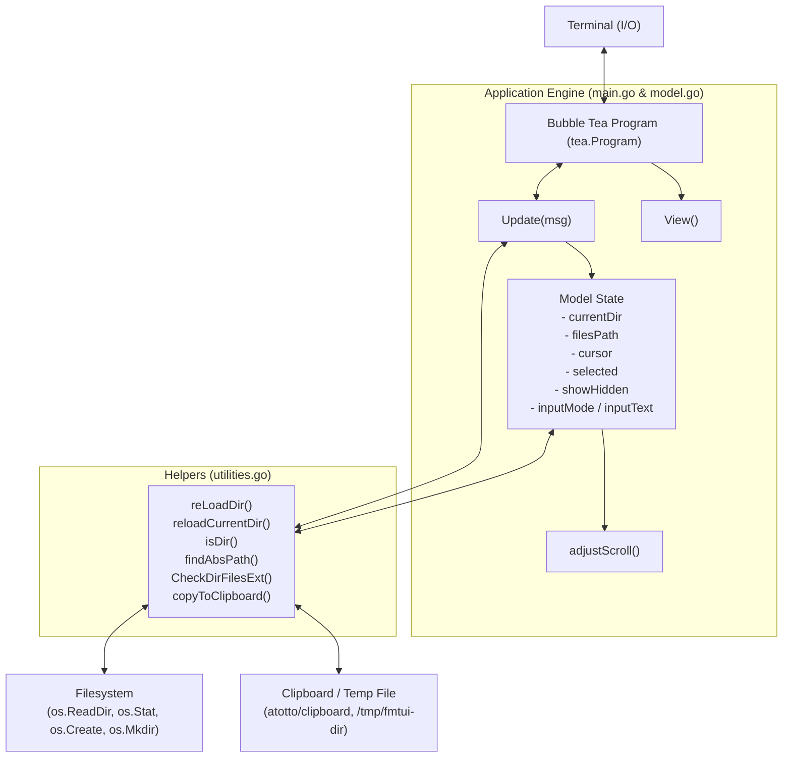
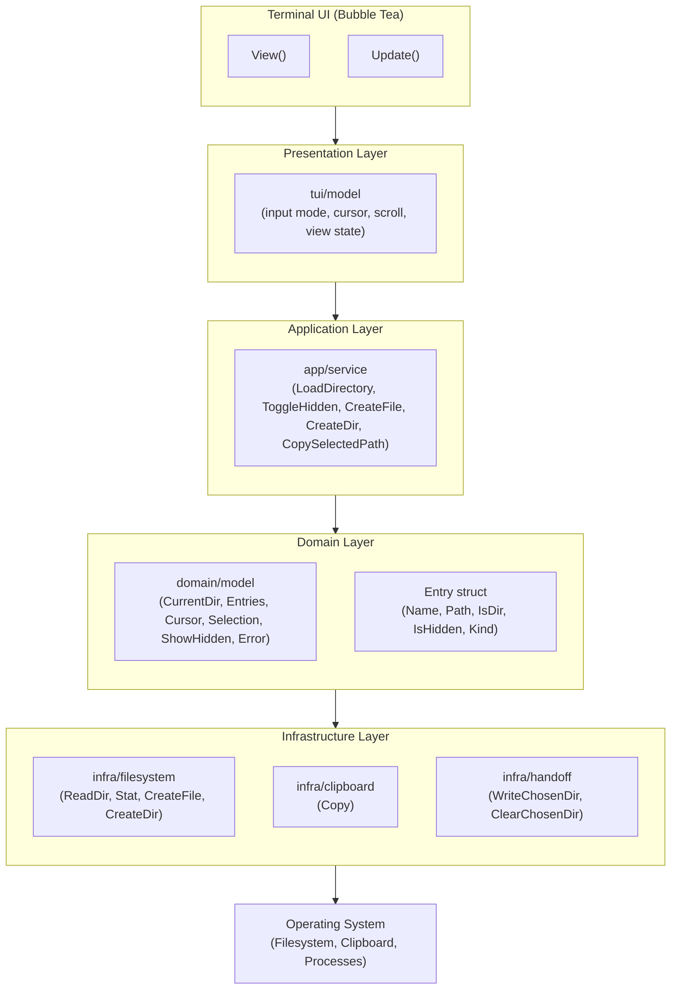
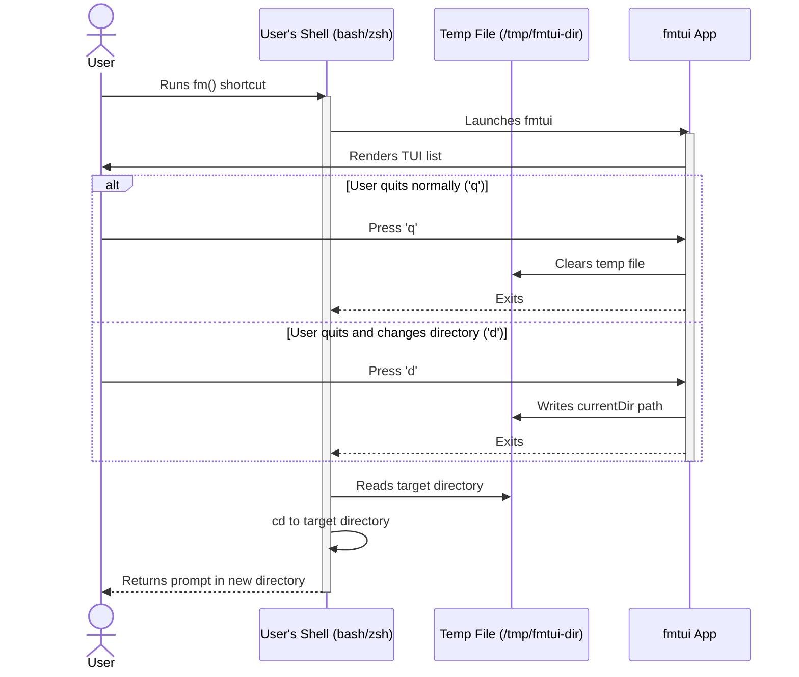

# Architecture Diagrams (Mermaid)

Below are the system architecture diagrams derived from [Plan.MD](file:///data/coding/Go/tui/list2/Plan.MD) represented in Mermaid markdown.

---

## 1. Current Architecture

This diagram visualizes the existing codebase design where bubbletea components directly interact with filesystem helpers and external dependencies.

---

## 2. Target Layered Architecture

This diagram shows the proposed package and layered design following a clean architecture style (Presentation -> Application -> Domain -> Infrastructure).

---

## 3. Shell Integration & Handoff Sequence

This sequence diagram details the interaction between the shell function wrappers, the temporary file directory handoff (`/tmp/fmtui-dir`), and the TUI application when directory switching (`d`) or normal exits (`q`) occur.

