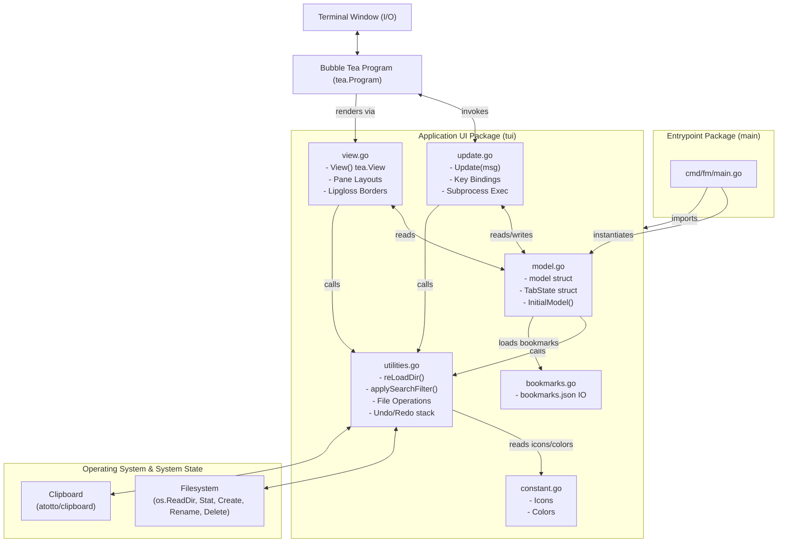
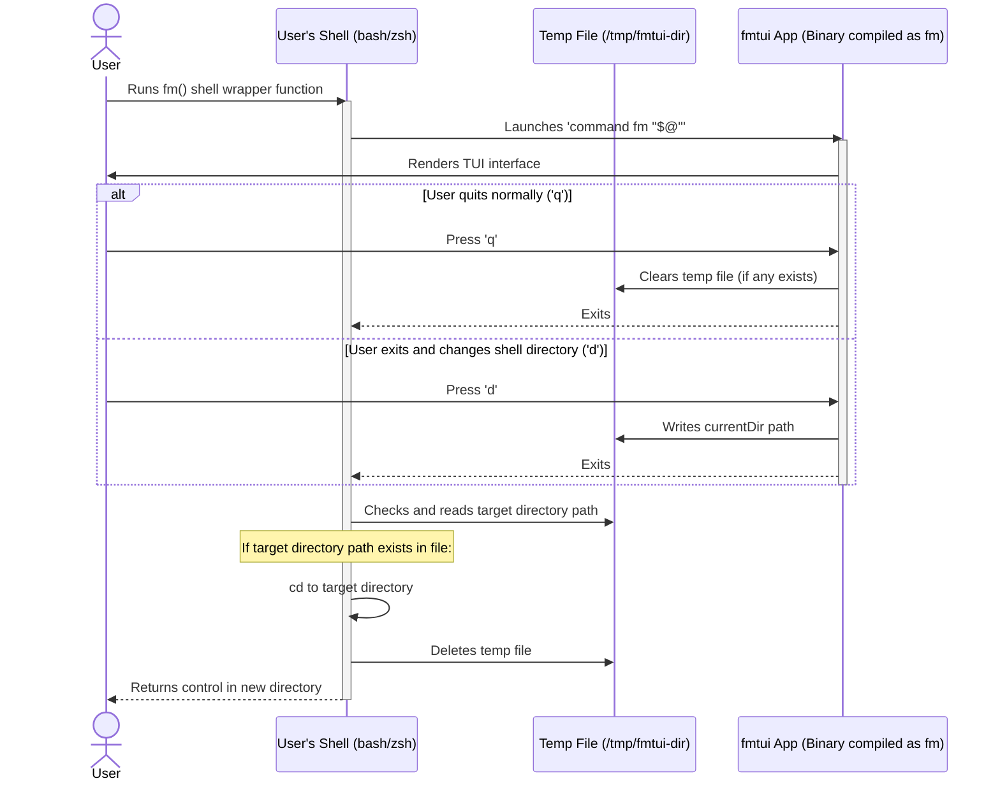

# Architecture Diagrams (Mermaid)

Below are the system architecture diagrams representing the modular packaging, layout math, and search filtering pipelines currently implemented in **fmtui**.

---

## 1. Modular Package Architecture

This diagram visualizes how the Bubble Tea runtime, state containers, and execution systems are split across modular files within the same `tui` package.



---

## 2. Search and Filter Pipeline

This flowchart outlines the real-time search filtering loop. The application avoids re-reading the filesystem directory on every keystroke by applying filters against the cached `t.filesPath` into a dynamic `t.filteredFiles` slice.

```mermaid
flowchart TD
    User["User Types Char in Search Mode"] -->|triggers Update()| KeyMsg["tea.KeyMsg"]
    KeyMsg -->|appends char| SearchText["m.searchText"]
    SearchText -->|calls| Filter["applySearchFilter()"]
    
    subgraph Cache ["TabState Filtering Engine"]
        Filter -->|checks query against| FilesPath["t.filesPath (Full Directory Cache)"]
        FilesPath -->|matches contain query| Filtered["t.filteredFiles (Muted Search Results)"]
    end
    
    Filter -->|resets cursor and scroll| ResetScroll["t.cursor = 0\nt.scrollOffset = 0"]
    Filtered -->|returns| VisibleFiles["t.visibleFiles() helper"]
    
    VisibleFiles -->|determines active listing| View["view.go / View() Renders Filtered List"]
    VisibleFiles -->|targets file for action| Ops["update.go / File Operations (Delete, Rename, Open)"]
```

---

## 3. Shell Integration & Exit Directory Handoff

This sequence diagram details the interaction between the shell wrapper function `fm()`, the handoff file `/tmp/fmtui-dir`, and the **fmtui** Go program.


