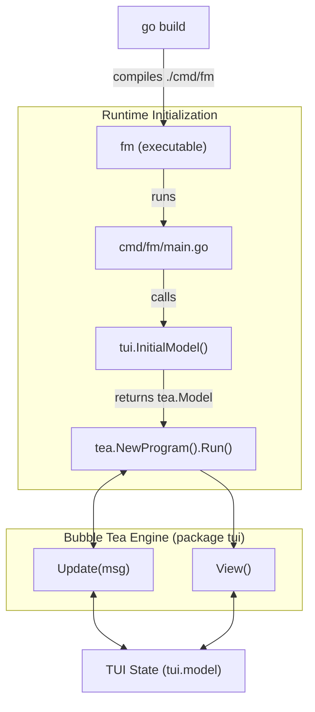

# System Architecture - fmtui

This document provides a high-level overview of the **fmtui** file manager architecture, directory layout, and component flow.

---

## 1. Directory Structure and Package Layout

The codebase follows the standard Go project structure layout:

```
.
├── cmd/
│   └── fm/
│       └── main.go           # Application entrypoint (package main)
├── internal/
│   └── tui/                  # Private application package (package tui)
│       ├── model.go          # Application state structs and initializers
│       ├── update.go         # Key, mouse, and process update loop
│       ├── view.go           # Split-pane UI rendering logic
│       ├── utilities.go      # Directory loading, permissions, actions, and undo/redo
│       ├── constant.go       # ANSI colors, icons, and constants
│       ├── bookmarks.go      # Bookmarks configuration load/save
│       └── tui_test.go       # Unit test suite
├── go.mod
├── go.sum
├── Makefile                  # Helper build targets
├── build.sh                  # Compilation script
└── cd-on-exit.sh             # Shell integration script
```

---

## 2. Compile and Runtime Flow



---

## 3. Sub-file Roles in `internal/tui`

To prevent monolithic source files, the `tui` package's primary duties are split across three modular files:
- **`model.go`**: Defines structures like `model` (overall TUI state), `TabState` (independent explorer paths and file selections), and `ActionRecord` (undo/redo action history).
- **`update.go`**: Handles incoming messages and keyboard inputs. Includes focus changes, cursor movement, tab management, opening editors, and prompting deletion, renaming, and permissions.
- **`view.go`**: Implements the layout rendering engine. Calculates exact column widths (2/3 left explorer pane, 1/3 right preview pane) and vertical lines so that scrolling behaves cleanly without vertical clipping.

---

## 4. Shell Integration Handoff

When the user exits **fmtui** using `d` (change directory and exit), the application writes its current directory path to `/tmp/fmtui-dir`.
The shell wrapper function `fm()` (defined in `cd-on-exit.sh`) catches this file on exit, issues a `cd` command, and removes the handoff file.

See [architecture_diagrams.md](file:///data/coding/Go/tui/poc-fmtui/.gemini/architecture_diagrams.md) for sequence and detailed pipeline diagrams.
