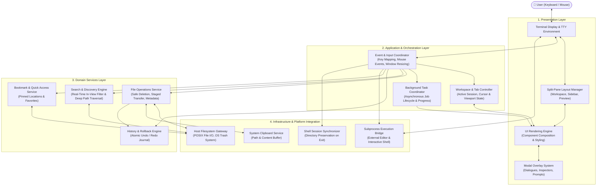

# 1. System Architecture Diagram (Conceptual)

This diagram illustrates the conceptual architecture of the file manager, organized into distinct architectural layers and functional subsystems. It highlights the separation of concerns between presentation, orchestration, domain capabilities, and host platform integrations.

---

## Conceptual Layered Architecture

---

## Architectural Principles

1. **Strict Layer Separation**: The Presentation Layer renders views strictly based on domain and application state; it never performs direct filesystem mutations.
2. **Safe Mutation & Recoverability**: Modifying operations are funneled through the File Operations Service, which logs actions to the History & Rollback Engine and routes deletions to the OS Trash.
3. **Decoupled Asynchronous Tasks**: Heavy operations (such as large file transfers or deep filesystem walks) are coordinated asynchronously to ensure terminal responsiveness at all times.
4. **Transparent Environment Integration**: The application acts as a good UNIX citizen, providing native handoffs to the user's shell and delegating complex editing to external tools.
