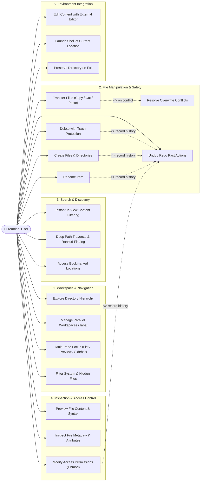

# 2. Use Case Diagram (Conceptual)

This diagram models the functional goals and capabilities provided to the user, organized by domain. It focuses purely on user objectives and business capabilities rather than specific keybindings or implementation mechanics.

---

## Conceptual Use Case Model

---

## Functional Capabilities Summary

| Capability Domain | User Goal | Business Value |
|---|---|---|
| **Workspace & Navigation** | Efficiently browse file hierarchies and manage multiple concurrent work contexts. | Reduces context switching and speeds up developer navigation across large projects. |
| **File Manipulation & Safety** | Perform routine file mutations with an ironclad safety net. | Protects against accidental data loss via Trash integration and multi-step Undo/Redo. |
| **Search & Discovery** | Find items instantly regardless of whether they are in the current directory or buried deep within the tree. | Combines zero-latency in-memory filtering with ranked deep-search algorithms. |
| **Inspection & Control** | Verify file contents and permissions without leaving the file manager. | Eliminates unnecessary tool invocations for read-only inspection. |
| **Environment Integration** | Seamlessly bridge between the TUI, preferred external text editors, and parent shell sessions. | Ensures the tool feels like an integral extension of the terminal environment. |
