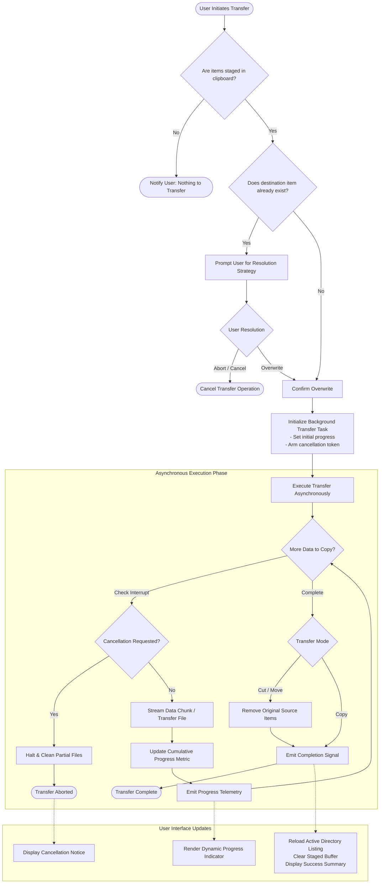
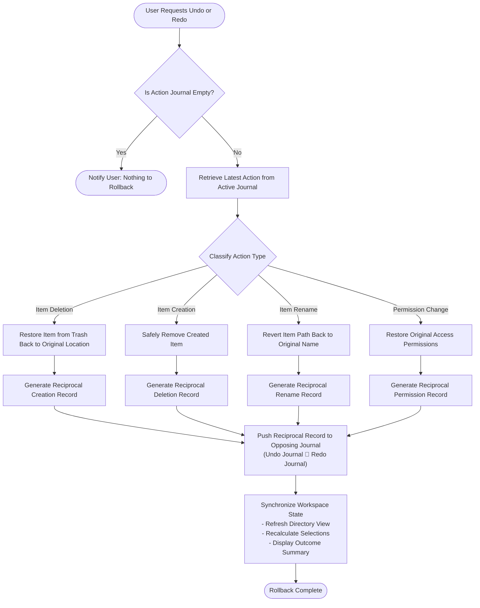

# 3. Activity Diagrams (Conceptual)

This document contains conceptual activity diagrams modeling the business processes, decision logic, and operational workflows for key file manager capabilities.

---

## 1. Asynchronous File Transfer & Conflict Resolution

Illustrates the end-to-end process of transferring files, handling destination collisions, reporting background progress, and cleaning up source items.



---

## 2. Intelligent Deep Search & Relevance Ranking (Quick Find)

Details the algorithm for discovering candidate paths, pruning noisy branches, scoring matches, and ranking results.

```mermaid
flowchart TD
    StartSearch([User Requests Quick Find]) --> IdentifyRoots["Resolve Search Scopes\n(User Home, Active Project Root, System Data Stores)"]
    IdentifyRoots --> CheckQuery{Is search query empty?}
    CheckQuery -->|Yes| ShowBookmarks["Display Pinned Bookmarks Only"] --> PresentUI([Render Search Overlay])

    CheckQuery -->|No| InitTraverse["Initialize Depth-Bounded Tree Traversal"]

    subgraph TraversalAndScoring ["Tree Traversal & Scoring Engine"]
        InitTraverse --> DepthGuard{Current Depth > Threshold?}
        DepthGuard -->|Yes (Exceeds Limit)| PruneBranch[Prune Branch / Return]
        DepthGuard -->|No| InspectEntries["Inspect Current Directory Entries"]

        InspectEntries --> EvaluateEntry{For Each Item}
        
        EvaluateEntry --> IsIgnored{Is System Noise or Excluded?\ne.g. Version Control, Build Output, Caches}
        IsIgnored -->|Yes| SkipEntry[Skip Branch / Item]
        IsIgnored -->|No| CheckDirectory{Is Directory?}

        CheckDirectory -->|Yes| Descend["Descend to Subdirectory (Depth + 1)"]
        CheckDirectory -->|No| ScoreItem["Calculate Relevance Score"]

        Descend --> DepthGuard
        ScoreItem --> MatchQuality{Match Tier}
        MatchQuality -->|Exact Basename Match| Tier1["Assign High Priority Score (Tier 1)"]
        MatchQuality -->|Prefix Basename Match| Tier2["Assign Medium Priority Score (Tier 2)"]
        MatchQuality -->|Partial Basename Match| Tier3["Assign Standard Priority Score (Tier 3)"]
        MatchQuality -->|No Match| DiscardItem[Discard]

        Tier1 & Tier2 & Tier3 --> CollectCandidate["Register Candidate Result"]
        SkipEntry & DiscardItem & CollectCandidate --> NextEntry{More Entries?}
        NextEntry -->|Yes| EvaluateEntry
        NextEntry -->|No| CompleteTraversal[Finish Traversal]
    end

    CompleteTraversal --> RankResults["Stable Sort Candidates by Relevance Score"]
    RankResults --> LimitTop["Merge Bookmarks & Truncate to Top Matches"]
    LimitTop --> PresentUI
```

---

## 3. Action Rollback & History Management (Undo / Redo)

Models the atomic inversion of past actions and reciprocal journal tracking.


