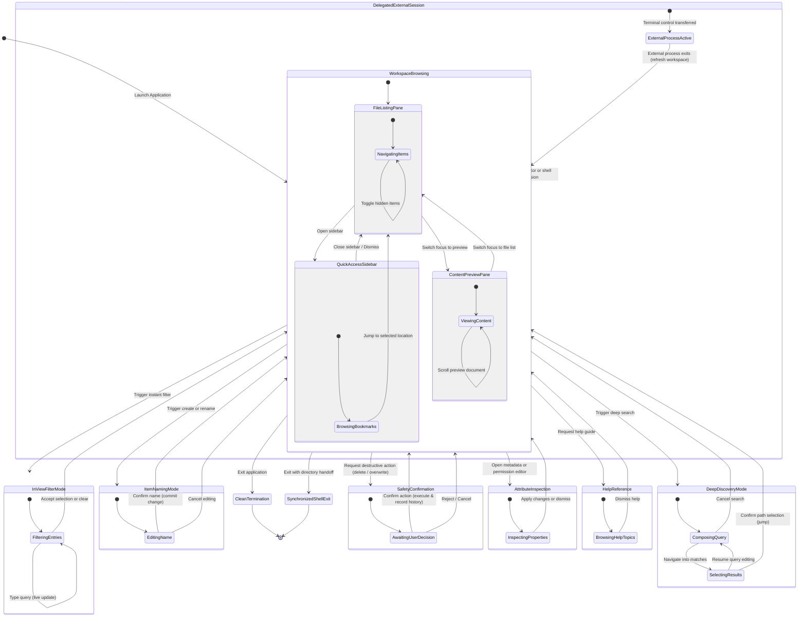

# 4. State Machine Diagram (Conceptual)

This diagram models the file manager's operational modes, user mental states, and interaction transitions. It abstracts away low-level flags in favor of clear functional states.

---

## Conceptual State Machine

---

## Operational Modes Summary

| Mode | Role & User Intent | Typical Transitions |
|---|---|---|
| **Workspace Browsing** | The primary exploration hub. Users navigate folders, inspect live file previews, manage tabs, and browse bookmarks. | Transitions freely between panes; acts as the launchpad for all other modes. |
| **In-View Filter Mode** | Zero-latency content discovery. Narrows the active folder's file list as characters are typed. | Returns to Browsing on confirmation or escape. |
| **Deep Discovery Mode** | Global search across project scopes. Provides two-stage interaction: query composition and ranked result selection. | Jumps directly to the selected item upon confirmation. |
| **Item Naming Mode** | Captures input for creating new files, new directories, or renaming items. | Commits filesystem changes or aborts cleanly. |
| **Safety Confirmation** | Prevents unintended data loss by confirming destructive deletions or file overwrite collisions. | Commits verified action to trash/disk or aborts. |
| **Attribute Inspection** | Allows deep examination of file properties, sizes, MIME types, and editing access permission flags. | Applies updated permissions or closes. |
| **Delegated External Session** | Temporarily pauses the file manager to give full terminal control to external tools ($EDITOR, interactive subshell). | Automatically resumes the file manager and syncs file changes upon process exit. |
| **Synchronized Shell Exit** | Exits the TUI while signaling the parent shell to update its current working directory to match the TUI's location. | Terminates the application session. |
