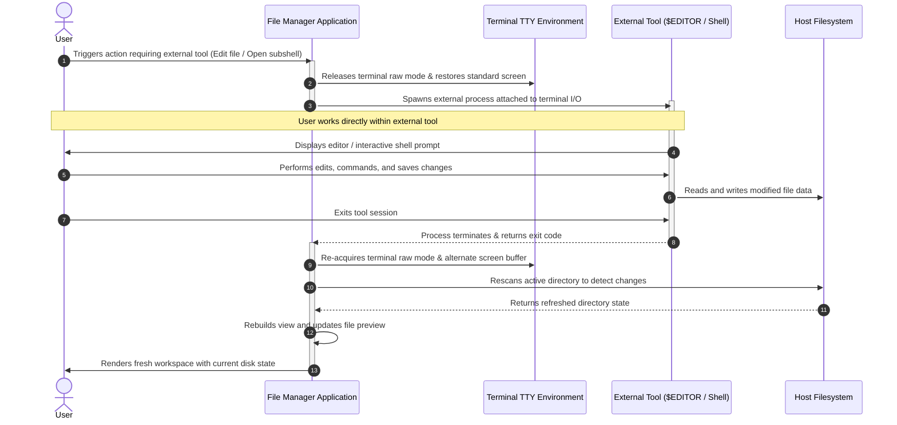
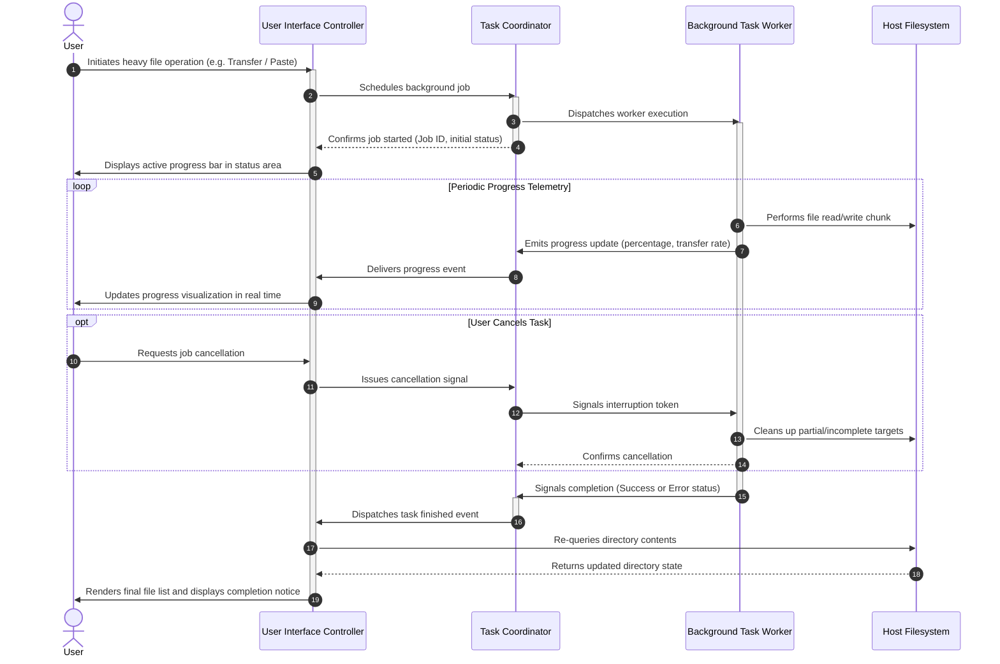

# 5. Sequence Diagrams (Conceptual)

This document presents system-level sequence diagrams illustrating the chronological interactions between the user, the file manager application, the host environment, and background tasks.

---

## 1. Shell Environment Synchronization on Exit

Illustrates how the file manager communicates its working context back to the user's parent shell upon termination.

```mermaid
sequenceDiagram
    autonumber
    actor User
    participant Shell as Parent Terminal Shell
    participant App as File Manager Application
    participant Handoff as Session State Handoff
    participant Storage as Host Filesystem

    User->>Shell: Invokes file manager command
    activate Shell
    Shell->>Handoff: Clears any previous session handoff state
    Shell->>App: Boots application process
    activate App

    App->>User: Displays interactive workspace (List, Preview, Status)

    loop Workspace Navigation
        User->>App: Navigates directories and workspaces
        App->>Storage: Queries directory entries & file metadata
        Storage-->>App: Returns file data
        App->>User: Renders updated view
    end

    alt Scenario A: Standard Termination
        User->>App: Requests standard exit
        App-->>Shell: Exits with success status
        deactivate App
        Shell->>Handoff: Checks for directory handoff signal (None found)
        Note over Shell: Remains in original working directory
    else Scenario B: Synchronized Directory Exit
        User->>App: Requests exit with directory synchronization
        App->>Handoff: Writes active working directory path
        App-->>Shell: Exits with success status
        deactivate App
        Shell->>Handoff: Checks for directory handoff signal (Signal Found!)
        Shell->>Handoff: Reads target directory path & clears state
        Shell->>Shell: Updates working directory to target path
    end

    Shell-->>User: Returns prompt in appropriate working directory
    deactivate Shell
```

---

## 2. External Subprocess Delegation & Workspace Resynchronization

Models the lifecycle of handing off terminal control to external tools (such as text editors or interactive shell sessions) and cleanly resuming.



---

## 3. Asynchronous Background Task & Real-Time Feedback

Visualizes decoupled background execution (e.g. large file copying or network transfers) with real-time UI telemetry and cancellation.


