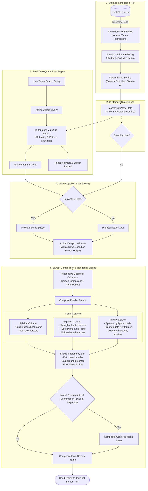

# 6. Data Flow & Rendering Pipeline (Conceptual)

This diagram visualizes the end-to-end data transformation pipeline: from raw storage entries on disk, through in-memory caching and real-time query filtering, to responsive split-pane layout composition and terminal rendering.

---

## Conceptual Data Transformation Pipeline

---

## Core Pipeline Principles

1. **Zero-Latency In-Memory Filtering**: Keystrokes filter the in-memory master state without triggering disk I/O, ensuring instantaneous typing response even on large directories.
2. **Deterministic Layout Math**: All column widths, row heights, and viewport offsets are computed before string rendering, preventing line wrapping glitches or display tearing.
3. **Decoupled Preview Generation**: File preview generation and syntax highlighting occur independently of the main listing window, allowing large files to be inspected smoothly.
